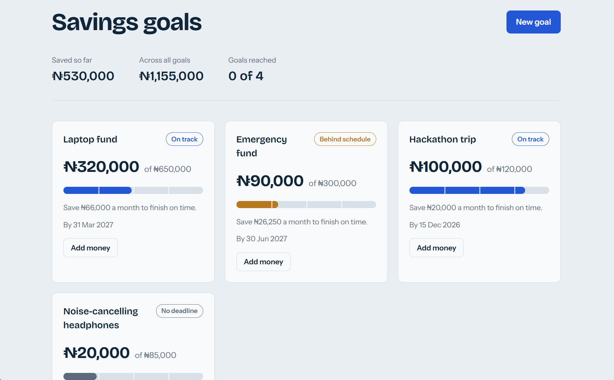

# Timex: Savings Goal Tracker

A web app for setting savings goals, logging your deposits and withdrawals, and seeing exactly how much to set aside each month, week, or day to hit your deadlines.

**Live demo:** https://savings-tracker-nu.vercel.app



## Features

**Goals**
- Create, edit, and delete savings goals with a target amount, an optional deadline, and an optional starting balance
- Progress bars with 25%, 50%, and 75% milestone marks
- Status badges that compare your savings against the time passed: On track, Behind schedule, Past deadline, No deadline, or Goal reached

**Money in and out**
- Add money to a goal or withdraw from it, with a date and an optional note
- Withdrawals can't exceed what you've saved, and dates can't be in the future
- Full contribution history for each goal, with a running balance after every entry, and the option to remove a mistaken entry

**Savings pace**
- See how much to save per **month**, **week**, or **day** to finish each goal on time
- One toggle switches every pace figure in the app: goal cards, the overview panel, the next-deadline card, and the onboarding preview
- An overview panel totals the amount across all active goals, listed soonest deadline first

**Dashboard**
- Summary of total saved, total target, and goals reached
- "Next target due" card for your closest deadline
- Recent activity feed across all goals
- Search goals by name, filter by status, and sort by deadline, target, progress, or name

**Everything else**
- Landing page, sign-in and sign-up screens, and a first-goal onboarding flow
- Your data is saved in the browser, so it's still there when you come back
- Responsive layout, keyboard-friendly modals, and status shown with text as well as color

## Tech Stack

React 19, TypeScript, Vite, and plain CSS. No UI library and no backend. Deployed on Vercel.

## Run Locally

```bash
git clone https://github.com/dadatim/savings-tracker.git
cd savings-tracker
npm install
npm run dev
```

Other scripts:

| Command | What it does |
| --- | --- |
| `npm run build` | Type-checks and builds for production |
| `npm run preview` | Serves the production build locally |
| `npm run lint` | Runs ESLint |

## Project Structure

```
src/
  components/   UI: goal cards, forms, history, pace overview, dashboard widgets,
                landing, auth, and onboarding screens
  hooks/        useLocalStorage (persists state and validates what it reads back)
  utils/        goal calculations, money and date formatting, runtime checks
  data/         sample goals shown on first load
  types.ts      shared TypeScript types
```

The core logic lives in `src/utils/goals.ts`. A goal's saved amount is always calculated from its contributions rather than stored separately, so the numbers can't drift out of sync. Currency is set by two constants at the top of that file (`CURRENCY` and `LOCALE`).

## Good to Know

- **Data stays in your browser.** It's stored in `localStorage` for that device and browser, so it doesn't sync across devices.
- **Sign-in is a front-end demo.** There are no real accounts or server, so nothing you enter on the auth screens is sent anywhere.

## What's Next

- A real backend with accounts, so goals sync across devices
- A chart of savings over time on each goal
- Recurring contributions and reminders
- Export history to CSV
- Automated tests for the goal calculations

## Author

Timothy Dada | [LinkedIn](https://www.linkedin.com/in/timothy-dada-b2a277309/) | [GitHub](https://github.com/dadatim)
